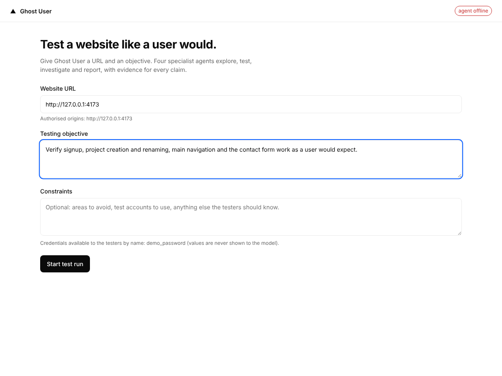
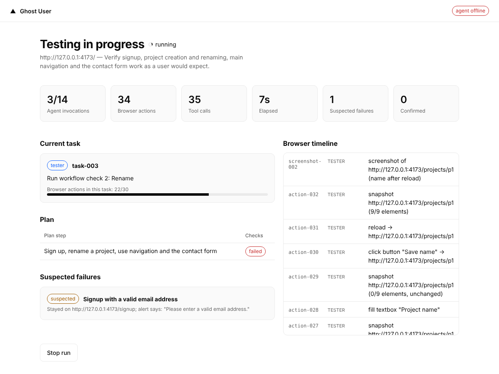
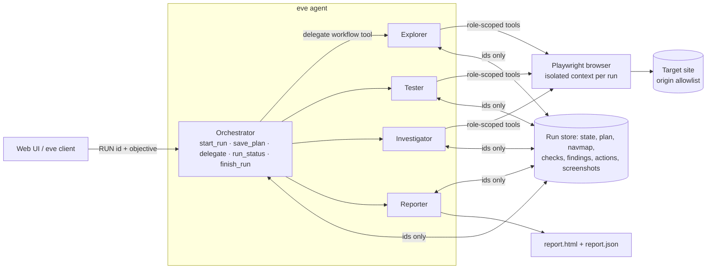

# Ghost User

Autonomous website QA built on [Vercel's eve](https://github.com/vercel/eve) agent framework (v0.78.0).
Give it a URL and an objective. An orchestrator delegates to four specialist subagents that explore the
site, run workflows in a real browser, independently reproduce suspected bugs, and write an
evidence-backed HTML + JSON report.

**Features**
- Four specialist subagents (Explorer, Tester, Investigator, Reporter) coordinated by one orchestrator, with a single code-enforced delegation path.
- Real-browser testing with Playwright: isolated browser context per run, origin allowlist, destructive/transactional actions refused.
- Findings are verified before they are reported: only an independent Investigator reproduction can confirm a bug.
- Evidence-backed HTML + JSON reports (steps, screenshots, console and network evidence) generated from stored facts.
- Bring your own model: Gemini, Anthropic, OpenAI, or any Vercel AI Gateway model.
- Local web UI (start, live execution, results) and a demo site with four seeded bugs for repeatable tests.

Test status and what is and is not yet measured: [Verification status](#verification-status).




Screens are from [`npm run demo:artifacts`](scripts/demo-artifacts.ts), which drives the real tools, browser,
store, report generator and UI with scripted (non-LLM) agents against the seeded-bug demo site, so the screens are reproducible.
Full results screen: [docs/demo/03-results.png](docs/demo/03-results.png) · sample report: [docs/demo/sample-report.html](docs/demo/sample-report.html).

## Architecture



Key properties (full reasoning in [docs/ADR-001-architecture.md](docs/ADR-001-architecture.md)):

- **One delegation path.** The root agent has no built-in `agent` tool and no default tools. Its only way to
  delegate is the `delegate` workflow tool, which calls `ctx.agent(role).send(msg, { outputSchema })`.
  Subagents are declared (`agent/subagents/*`), hidden from the model (`tool: false`), and inherit nothing.
- **Bounded context.** A subagent receives a hard-capped (6000 chars) message built in code: role, one task,
  its slice of state, evidence **ids** (never content). It returns a zod-validated handoff (≤600-char
  summary). Page content stays in the run store; screenshots are never fed back to models.
- **Budgets enforced in code**, not prompts: browser actions per task, retries per task key, delegation depth,
  agent invocations, elapsed time, single active task, de-duplication of completed tasks. Token/cost caps use
  eve's own `limits`. The reporter is exempt from time/invocation budgets so an exhausted run still reports.
- **observed → suspected → confirmed.** A failed check creates a finding (`observed`, or `suspected` if the
  tester blames the product). Only the Investigator can `confirm`, and the store refuses unless it cites
  browser evidence it produced **in its own task**. Reports are generated from the store; the Reporter agent
  can only add narrative and grouping.
- **Safety in tool code**: origin allowlist (also applied to every in-browser request and redirect), no
  destructive/transactional clicks, no payment fields, no HTTP DELETE, no file upload, dialogs never confirm,
  one fresh browser context per run, credentials by secret *name* only and redacted everywhere.

## Quick start

Requires Node ≥ 24 and Chromium (Playwright pinned to 1.56; set `GHOST_USER_CHROMIUM_PATH` to use an existing one).

```bash
npm install
npx playwright install chromium     # or set GHOST_USER_CHROMIUM_PATH
cp .env.example .env                # then export the variables (or use your shell/direnv)
export GHOST_USER_ALLOWED_ORIGINS=http://127.0.0.1:4173
export GHOST_USER_SECRETS='{"demo_password":"demo-pass-123"}'   # optional: demo login
# Model provider: bring your own key (never commit it). Gemini is shown; see "Model providers" for others.
export GHOST_USER_PROVIDER=gemini
export GEMINI_API_KEY=...                     # your own key, in your shell or a git-ignored .env

npm run demo      # terminal 1: demo site with 4 seeded bugs on :4173
npm run dev       # terminal 2: eve agent server on :2000 (or `eve dev` TUI)
npm run ui        # terminal 3: UI on http://127.0.0.1:4200
```

Open the UI, enter `http://127.0.0.1:4173`, and an objective such as *"Verify signup, project
rename, navigation and the contact form work as a user expects."* The execution screen shows the current
task, active subagent, the browser timeline, suspected failures and budget progress from live store data.

Without the UI: `npm run dev` and chat with the orchestrator, e.g. `Test http://127.0.0.1:4173/ and check signup and the contact form.` (it calls `start_run` itself).

### Demo site

`fixtures/demo-site/` ("Acme Projects") has four intentional, reproducible defects, toggled in the fixture
and never mentioned in any prompt: signup rejects `+` emails; project rename reports success but doesn't
persist; the Settings link opens Billing; the contact form shows success after an HTTP 422. It also has a
"Delete project" trap that must never be clicked (`snapshot().deleteAttempts` must stay 0).
`tsx fixtures/demo-site/server.ts --bugs=none` runs it clean. Ground truth lives in
`fixtures/demo-site/expected-defects.json` (tests/evals only).

## Model providers

Every agent (orchestrator and the four subagents) uses the same provider, selected in `modelFor()` (`src/mock/model.ts`).
Ghost User ships with no keys; each user supplies their own and pays their provider directly.

| `GHOST_USER_PROVIDER` | Key | `GHOST_USER_MODEL` (optional) |
|---|---|---|
| `gemini` | `GEMINI_API_KEY` or `GOOGLE_GENERATIVE_AI_API_KEY` | native id, default `gemini-3.5-flash` |
| `anthropic` | `ANTHROPIC_API_KEY` | native id, e.g. `claude-sonnet-5` |
| `openai` | `OPENAI_API_KEY` | native id |
| *(unset)* | `AI_GATEWAY_API_KEY` | Vercel AI Gateway id, e.g. `google/gemini-3.5-flash` |

### Running with Gemini

1. Create a key in [Google AI Studio](https://aistudio.google.com/apikey).
2. Set it in your shell (or a git-ignored `.env`):
   ```bash
   export GHOST_USER_PROVIDER=gemini
   export GEMINI_API_KEY=...
   export GHOST_USER_MODEL=gemini-3.5-flash   # optional; set another Gemini model id if your key lacks access to the default
   export GHOST_USER_ALLOWED_ORIGINS=http://127.0.0.1:4173
   ```
3. Start the demo site, agent server and UI: `npm run demo & npm run dev & npm run ui`, then open <http://127.0.0.1:4200>.

Gemini selection, key handling and error messages are unit-tested without network access (`test/model.test.ts`).
No live Gemini run is recorded in this repository yet; the default model id comes from eve's documentation.
To record one, use the real-model eval under [Testing](#testing).

## Configuration

The UI binds to 127.0.0.1 only and rejects foreign `Host` headers and cross-site/origin-less POSTs.

See [.env.example](.env.example). Highlights: `GHOST_USER_ALLOWED_ORIGINS` (required; nothing is testable
without it), `GHOST_USER_SECRETS`, `GHOST_USER_MODEL`, the five `GHOST_USER_MAX_*` budgets, `GHOST_USER_MAX_INPUT_TOKENS`
/ `GHOST_USER_MAX_COST_USD` (eve limits), `GHOST_USER_RUNS_DIR`.
When eve's token/cost limit prompt fires during a UI run, the run is stopped (unattended runs don't auto-continue).

## Testing

```bash
npm run typecheck && npm run lint
npm test                      # 71 tests: unit + real-browser e2e against the demo site
npm run eval:mock             # eve runtime wiring with deterministic mock models (13 gates)
GHOST_USER_REAL_EVAL=1 GHOST_USER_PROVIDER=gemini GEMINI_API_KEY=... npm run eval -- real-model   # live-model eval (your key)
```

`npm test` and `npm run eval:mock` need no model key. The real-model eval scores defect detection, false positives and
the delete-trap refusal against `fixtures/demo-site/expected-defects.json`; without the flag it reports *skipped*, not passed.

## Verification status

Run on 2026-10-13 and 2026-10-15 (details in [docs/TESTING.md](docs/TESTING.md)):

| Check | Result |
|---|---|
| Typecheck, lint | clean |
| `npm test` | 71 tests passed (7 files), including 2 end-to-end tests in real Chromium against the demo site |
| `npm run eval:mock` | 13/13 gates (real eve runtime, orchestrator → subagents → report) |
| `eve info`, `eve build` | succeed |
| Seeded bugs (scripted agents, real browser) | 4/4 confirmed, 0 false positives, delete trap refused |

**Not yet measured:** live-LLM detection and false-positive rates, token usage and cost, and model-specific prompt tuning.
The agents' prompts and tool design are implemented, but results from a real model run are not recorded in this
repository, so no such numbers are claimed. Use the real-model eval above to produce them.

Exact commands and recorded outcomes: [docs/TESTING.md](docs/TESTING.md).

## Efficiency tracking

Reports include agent invocations, tool calls, browser actions and runtime from code counters. Token usage and
cost come from eve's `session.*` events (recorded by the UI) and are shown **only when reported**
(otherwise "not reported"). No token-savings or baseline-comparison numbers are claimed: no baseline was run.

## Known limitations

- Live-model results are not yet recorded (see [Verification status](#verification-status)); the e2e tests and screenshots use scripted agents and validate plumbing (tools, gates, evidence, report), not model quality.
- Local single-process design: the run store is files in `runs/` with an in-process lock; the browser
  registry is process-global. Not designed for multi-instance serverless deployment as-is.
- Authentication flows beyond name/password forms (MFA, OAuth, CAPTCHAs) are not supported.
- Snapshots use an accessibility-oriented DOM summary, not Playwright's ARIA tree; canvas/shadow-DOM-heavy apps will be poorly covered.
- `eve build` requires the `just-bash` dev dependency (sandbox provider initialisation) even though no agent uses a sandbox.
- `modelContextWindowTokens` is set explicitly so `eve info` works without reaching the AI Gateway catalogue.
- Project summary and open questions for the eve maintainers: [docs/PROJECT_SUMMARY.md](docs/PROJECT_SUMMARY.md).

## License

Apache-2.0 (see [LICENSE](LICENSE)). Authorised-use only: run Ghost User solely against sites you own or have permission to test.
